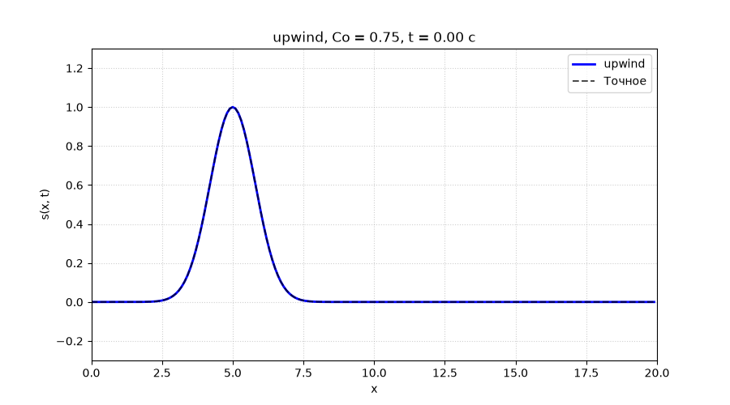

# Лабораторная работа №2: Основы численных схем на примере уравнения переноса

Численное решение линейного уравнения переноса (одномерный случай) явными разностными схемами с исследованием устойчивости, численной диффузии и дисперсии.



*Анимация: перенос гауссова импульса схемой «против потока» (Upwind) при Co = 0.75. Видно постепенное «расплывание» пика — численная диффузия.*

---

## Содержание

- [О проекте](#о-проекте)
- [Реализованные схемы](#реализованные-схемы)
- [Структура проекта](#структура-проекта)
- [Установка](#установка)
- [Запуск](#запуск)
- [Теория (кратко)](#теория-кратко)
- [Результаты](#результаты)
- [Тесты](#тесты)

---

## О проекте

Цель работы — численно решить **линейное уравнение переноса**:

$$
\frac{\partial s}{\partial t} + u \frac{\partial s}{\partial x} = 0, \qquad u = \text{const} > 0
$$

и сравнить поведение классических явных разностных схем. Уравнение переноса — простейший представитель класса гиперболических законов сохранения, к которым относятся и полные уравнения газовой динамики (Эйлера, Навье–Стокса). Оно сохраняет все ключевые математические трудности, но допускает **точное аналитическое решение**:

$$
s(x, t) = s^0(x - ut)
$$

— профиль просто сдвигается вправо без изменения формы. Это решение служит эталоном для проверки численных схем.

**Что исследуется:**
- устойчивость схем (условие Куранта–Фридрихса–Леви, \(Co \le 1\));
- численная диффузия (размазывание профиля схемами 1-го порядка);
- численная дисперсия (паразитные осцилляции у схем 2-го порядка);
- влияние числа Куранта на качество решения.

---

## Реализованные схемы

| Схема | Порядок | Устойчивость | Тип погрешности |
|---|---|---|---|
| **Против потока** (Upwind) | 1-й | \(0 \le Co \le 1\) | Численная диффузия |
| **FTCS** (центральная разность) | 2-й | **Безусловно неустойчива** | — (демонстрация «взрыва») |
| **Лакса** | 1-й | \(\lvert Co \rvert \le 1\) | Численная диффузия |
| **Лакса–Вендроффа** | 2-й | \(\lvert Co \rvert \le 1\) | Численная дисперсия |

**Ключевой параметр** — число Куранта:

$$
Co = \frac{u \, \Delta t}{\Delta x}
$$

Физический смысл: сколько ячеек сетки проходит волна за один шаг по времени. Условие устойчивости явных схем: \(Co \le 1\).

---

## Структура проекта

```
lab 2/
├── docs/
│   └── upwind.gif          # анимация (для README)
├── solver.py               # ядро: AdvectionSolver, профили, шаги схем
├── errors.py               # нормы ошибок L1/L2/L∞, ширина FWHM
├── cli.py                  # командный интерфейс (click + matplotlib)
├── test_solver.py          # автотесты (pytest)
├── requirements.txt        # зависимости
├── .gitignore
└── README.md
```

### `solver.py` — ядро

- `AdvectionSolver` — класс с сеткой, шагами схем, точным решением.
  - `solve(scheme, profile, Co, t_final)` — прогоняет схему до заданного времени.
  - `exact_solution(profile, t)` — точное решение \(s^0((x - ut) \bmod L)\).
- `profile_step` — ступенька (разрыв).
- `profile_gaussian` — гауссов импульс (гладкий профиль).
- `profile_parabola` — парабола (гладкая, но с разрывами производной).

### `errors.py` — метрики

- `compute_errors(s_num, s_exact)` — нормы \(L_1\), \(L_2\), \(L_\infty\).
- `compute_fwhm(x, s)` — ширина пика на полувысоте (FWHM).

### `cli.py` — команды

| Команда | Что делает |
|---|---|
| `test-stability` | Устойчивость всех схем при \(Co = 0.8\) и \(Co = 1.2\) |
| `compare-schemes` | Сравнение схем на трёх профилях в три момента времени |
| `study-courant` | Влияние числа Куранта на upwind |
| `animate` | Анимация переноса профиля (GIF/MP4) |

---

## Установка

```bash
# 1. Клонировать репозиторий
git clone https://github.com/ТВОЙ_НИК/lab2-advection.git
cd lab2-advection

# 2. Создать виртуальное окружение (рекомендуется)
python -m venv .venv
# Windows:
.venv\Scripts\activate
# Linux/macOS:
source .venv/bin/activate

# 3. Установить зависимости
pip install -r requirements.txt
```

---

## Запуск

### Проверка корректности (тесты)

```bash
pytest test_solver.py -v
```

Ожидаемо: **5 passed**. Тесты проверяют:
- точность upwind при \(Co = 1\);
- сохранение массы схемами upwind и Lax–Wendroff;
- неустойчивость FTCS;
- неустойчивость upwind при нарушении условия КФЛ (\(Co > 1\)).

### Визуализация

```bash
# Устойчивость схем (Co = 0.8 vs Co = 1.2)
python cli.py test-stability --output stability_test.png

# Сравнение схем на трёх профилях
python cli.py compare-schemes --output-prefix comparison

# Влияние числа Куранта
python cli.py study-courant --output courant_effect.png
```

### Анимация

```bash
# Upwind на гауссе — видно численную диффузию
python cli.py animate --scheme upwind --profile gaussian --output upwind.gif

# Lax-Wendroff на ступеньке — видна численная дисперсия
python cli.py animate --scheme lax_wendroff --profile step --output lw_step.gif
```

---

## Теория (кратко)

### Метод характеристик

Вдоль кривых \(\frac{dx}{dt} = u\) величина \(s\) не меняется. Это даёт точное решение \(s(x,t) = s^0(x - ut)\).

### Условие КФЛ

Область аналитической зависимости должна лежать внутри численной. Для схемы upwind это даёт:

$$
x_{i-1} \le x_i - u \Delta t \le x_i \;\Rightarrow\; Co \le 1
$$

Нарушение → потеря информации → «взрыв» решения.

### Модифицированное уравнение

Схема upwind на самом деле решает не уравнение переноса, а:

$$
\frac{\partial s}{\partial t} + u \frac{\partial s}{\partial x} = D_{\text{num}} \frac{\partial^2 s}{\partial x^2}, \qquad D_{\text{num}} = \frac{u \Delta x}{2}(1 - Co)
$$

Член \(D_{\text{num}} \partial^2 s/\partial x^2\) — это паразитная **численная диффузия**. При \(Co = 1\) она исчезает (\(D_{\text{num}} = 0\)), и схема upwind становится точной.

Схема Лакса–Вендроффа вместо диффузии добавляет **дисперсию**:

$$
\frac{\partial s}{\partial t} + u \frac{\partial s}{\partial x} = -\frac{u \Delta x^2}{6}(1 - Co^2) \frac{\partial^3 s}{\partial x^3}
$$

Отсюда — осцилляции у разрывов.

---

## Результаты

### 1. Устойчивость схем

| Co = 0.8 (устойчиво) | Co = 1.2 (неустойчиво) |
|---|---|
| Upwind, Lax, Lax–Wendroff — стабильны | Все схемы «взрываются» |
| FTCS — неустойчива даже при Co < 1 | — |

### 2. Численная диффузия и дисперсия

- **На гауссе:** upwind и Lax «расплывают» пик; Lax–Wendroff почти точно совпадает с эталоном.
- **На ступеньке:** upwind и Lax размывают фронт; Lax–Wendroff держит крутизну, но даёт осцилляции позади фронта.
- **На параболе:** осцилляции Lax–Wendroff локализованы в точках излома производной.

### 3. Влияние числа Куранта

При \(Co \to 0\) диффузия upwind максимальна. При \(Co = 1\) — исчезает (\(L_2\)-ошибка \(\to 0\)).

---

## Тесты

```bash
pytest test_solver.py -v
```

| Тест | Что проверяет |
|---|---|
| `test_courant_one_exactness` | Upwind при \(Co = 1\) точен |
| `test_mass_conservation_upwind` | Upwind сохраняет массу |
| `test_mass_conservation_lax_wendroff` | Lax–Wendroff сохраняет массу |
| `test_ftcs_instability` | FTCS взрывается |
| `test_upwind_instability_cfl_violation` | Upwind взрывается при \(Co > 1\) |

---

## Литература

1. Федулов В. А. Основы численных схем на примере уравнения переноса: метод. указания к ЛР №1. — М.: МГТУ им. Н.Э. Баумана, каф. СМ6, 2026.
2. Самарский А. А., Гулин А. В. Численные методы. — М.: Наука, 1989.
3. LeVeque R. J. Finite Volume Methods for Hyperbolic Problems. — Cambridge University Press, 2002.
